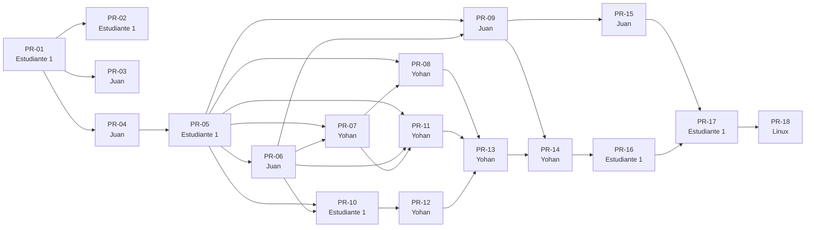

# Plan de integración

Cómo el código y la documentación entran al repositorio: **por etapas, en *pull requests* (PR) pequeños y revisados entre los integrantes**, nunca de golpe. Es el «plan de integración» que pide el Hito 1 del enunciado. Complementa [GIT_WORKFLOW.md](GIT_WORKFLOW.md) (reglas de Git y plantillas) y [PLAN_TRABAJO.md](PLAN_TRABAJO.md) (tareas, cronograma y tablero).

## Principios

1. **`main` siempre ejecutable y en verde.** Cada PR deja los tests pasando; el CI (GitHub Actions, Linux) lo comprueba en cada PR y en cada push a `main`.
2. **Un PR = un paquete coherente** (de 1 a 5 *commits*, uno por archivo o responsabilidad). Cada *commit* también deja los tests en verde.
3. **Revisión cruzada obligatoria**: cada PR lo aprueba un compañero distinto de su autor, según la rotación del enunciado: **A revisa a B, B revisa a C, C revisa a A**. Los comentarios se resuelven antes de integrar.
4. **Integración sin *squash***: se usa *merge commit* (o *rebase*) para conservar los *commits* individuales de cada autor.
5. **El orden respeta las dependencias** (ver el grafo): no se abre un PR hasta que los PR de los que depende estén integrados.
6. **Honestidad sobre el origen del código.** La base de código y de documentos se preparó con asistencia de un agente de IA (ver [../AI_USAGE.md](../AI_USAGE.md)) y se incorpora por etapas. Un PR solo se abre cuando su autor leyó, ejecutó y entendió lo que sube, y cada *commit* que incorpora esa base lo declara en su mensaje. Las fechas de los *commits* son las reales; no se reescribe el historial.
7. **Contribución propia visible**: además de incorporar la base, cada integrante hace *commits* propios (correcciones, tests, ajustes, explicaciones) en sus PR. La nota no depende del número de *commits* sino de su sustancia.

## Olas e hitos

| Ola | Hito del enunciado | Contenido | PR | Fechas previstas |
|---|---|---|---|---|
| Ola 0 | Hito 1 · Diseño | entorno, arquitectura, interfaces y álgebra base | PR-01, PR-02, PR-03, PR-04 | `[fecha inicio]` – `[fecha fin]` |
| Ola 1 | Hito 2 · Primera integración | escena, cámara/proyección y un contenedor con una pieza en pantalla | PR-05, PR-06, PR-07 | `[fecha inicio]` – `[fecha fin]` |
| Ola 2 | Hito 3 · Prototipo interactivo | entrada, HUD, homografía y animaciones | PR-08, PR-09, PR-10, PR-11 | `[fecha inicio]` – `[fecha fin]` |
| Ola 3 | Hito 4 · Integración final | demo, controlador, interfaz final, informe, pruebas de arquitectura y documentación | PR-12, PR-13, PR-14, PR-15, PR-16, PR-17 | `[fecha inicio]` – `[fecha fin]` |

## Lista de PR

| PR | Ola | Autor → revisor | Rama | Depende de | Qué incorpora | Commits | Tarea |
|---|---|---|---|---|---|---|---|
| PR-01 | 0 | Estudiante 1 → Yohan | `chore/entorno` | — | Entorno de desarrollo: configuración, plantillas, CI, README inicial y declaración de IA | 6 | T0 |
| PR-02 | 0 | Estudiante 1 → Yohan | `docs/arquitectura` | PR-01 | Arquitectura en capas, roles del equipo y reglas | 1 | T1 |
| PR-03 | 0 | Juan → Estudiante 1 | `docs/interfaces` | PR-01 | Documento de interfaces: convenciones, estructuras, contratos y ejemplo dorado | 1 | T1 |
| PR-04 | 0 | Juan → Estudiante 1 | `feature/core-algebra` | PR-01 | Álgebra lineal propia y runner de verificaciones | 3 | T3 |
| PR-05 | 1 | Estudiante 1 → Yohan | `feature/escena` | PR-04 | Módulo escena: piezas, mallas, contenedor y API create_scene / apply_action / get_geometry | 5 | T4 |
| PR-06 | 1 | Juan → Estudiante 1 | `feature/camara-proyeccion` | PR-05 | Módulo proyección: cámara (K, R, t, P), recorte y perspectiva | 3 | T5-T6 |
| PR-07 | 1 | Yohan → Juan | `feature/hito2-prototipo` | PR-05, PR-06 | Hito 2: un contenedor y una pieza proyectados con la matriz de cámara y dibujados en pantalla | 3 | T7 |
| PR-08 | 2 | Yohan → Juan | `feature/entrada` | PR-05, PR-07 | Entrada: teclado y ratón a comandos | 2 | T8 |
| PR-09 | 2 | Juan → Estudiante 1 | `feature/homografia` | PR-05, PR-06 | Experimento de homografía: derivación, DLT, ruido, paralaje y rotación pura | 2 | T10 |
| PR-10 | 2 | Estudiante 1 → Yohan | `feature/animacion-base` | PR-05, PR-06 | Animación: curvas, interpolación de poses y victoria (torre) | 4 | T11 |
| PR-11 | 2 | Yohan → Juan | `feature/hud` | PR-05, PR-06, PR-07 | HUD: texto de la pieza activa, cámara, matrices y estado | 2 | T8-T9 |
| PR-12 | 3 | Yohan → Juan | `feature/demo` | PR-10 | Modo demostración determinista | 2 | T12 |
| PR-13 | 3 | Yohan → Juan | `feature/controlador` | PR-08, PR-11, PR-12 | Controlador de la aplicación (modos, animaciones, avisos) sin DOM | 2 | T8-T12 |
| PR-14 | 3 | Yohan → Juan | `feature/interfaz-final` | PR-09, PR-13 | Interfaz final: panel de homografía, main definitivo y página principal | 3 | T9-T13 |
| PR-15 | 3 | Juan → Estudiante 1 | `docs/informe` | PR-09 | Informe: cadena de proyección, derivación de la homografía y resultados | 3 | T13 |
| PR-16 | 3 | Estudiante 1 → Yohan | `feature/pruebas-arquitectura` | PR-14 | Pruebas de arquitectura, grafo de dependencias y runner en el navegador | 3 | T13 |
| PR-17 | 3 | Estudiante 1 → Yohan | `docs/final` | PR-15, PR-16 | Documentación final: README, guía de sustentación y declaración de IA | 3 | T13 |
| PR-18 | 3 | quien pruebe en Linux → otro integrante | `docs/verificacion-linux` | PR-17 | Resultado real de la verificación en Linux (README) | 1 | T14 |

Cierre: etiqueta de versión (`v1.0`) y declaración de contribuciones, cuando todos los PR estén aprobados e integrados y el CI esté en verde.

## Qué sube cada integrante

**Estudiante 1 — A · escena y geometría**: PR-01 `chore/entorno`; PR-02 `docs/arquitectura`; PR-05 `feature/escena`; PR-10 `feature/animacion-base`; PR-16 `feature/pruebas-arquitectura`; PR-17 `docs/final`.

**Juan — B · cámara y proyección**: PR-03 `docs/interfaces`; PR-04 `feature/core-algebra`; PR-06 `feature/camara-proyeccion`; PR-09 `feature/homografia`; PR-15 `docs/informe`.

**Yohan — C · interfaz y animación**: PR-07 `feature/hito2-prototipo`; PR-08 `feature/entrada`; PR-11 `feature/hud`; PR-12 `feature/demo`; PR-13 `feature/controlador`; PR-14 `feature/interfaz-final`.

Revisiones: Estudiante 1 revisa los PR de Juan; Juan los de Yohan; Yohan los de Estudiante 1.

## Grafo de dependencias

## Definición de «PR terminado»

- [ ] La descripción sigue la plantilla (`.github/PULL_REQUEST_TEMPLATE.md`) e incluye la evidencia (salida de `node app/tests/run.js`, captura si se ve en pantalla).
- [ ] El check `tests` de GitHub Actions está en verde.
- [ ] Lo aprobó el revisor de la rotación (con comentarios sustantivos, no solo «OK») y se resolvieron los comentarios.
- [ ] El autor lo integró con *merge commit* o *rebase* y borró la rama.
- [ ] La tarea del tablero pasó a **terminada** y quedó enlazada a sus *commits* y al PR.

## Cambios al plan

Si el orden o el reparto cambian (bloqueos, ausencias, correcciones), se registra aquí con fecha real y motivo.

| Fecha | Cambio | Motivo | Quién |
|---|---|---|---|
| `[fecha]` | | | |
